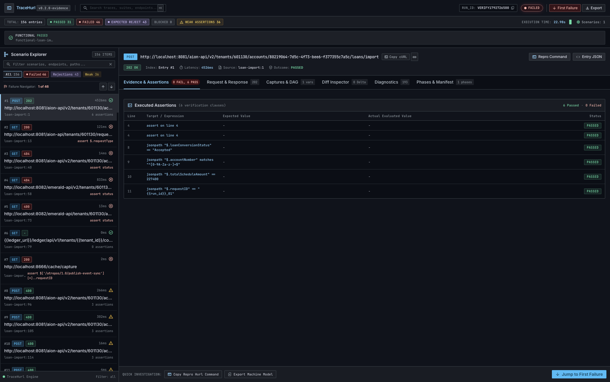

# TraceHurl

> **Evidence-First Verification Report CLI for Hurl Test Suites**



TraceHurl turns the raw artifacts of an integration and verification run into an interactive, evidence-first HTML report and a machine-readable JSON model. It normalizes run manifests, phase results, Hurl native JSON reports, request/response wire payloads, and runtime variables into a single deterministic view.

TraceHurl answers three critical questions within seconds:
1. **What failed?** Grouped by scenario and entry with immediate failure stepping.
2. **Why did it fail?** Exact expected vs. actual values, line numbers, and structured payload diffs.
3. **What evidence supports that conclusion?** Raw cURL repro commands, unredacted wire headers, and cryptographic artifact checksums.

It also performs automated test-quality analysis to flag weak assertions (e.g. `status >= 400`), missing assertions, undefined variables, and unasserted retries—ensuring a "green" test suite is never mistaken for proof.

---

## Table of Contents

- [Key Features](#key-features)
- [Design & User Experience](#design--user-experience)
- [Installation](#installation)
- [CLI Commands](#cli-commands)
- [Hurl Integration Guide & Runner Flags](#hurl-integration-guide--runner-flags)
  - [Mandatory Hurl Runner Flags](#mandatory-hurl-runner-flags)
  - [Recommended `run.sh` Harness](#recommended-runsh-harness)
- [Data Model & Verification Artifacts](#data-model--verification-artifacts)
- [Security & Redaction Invariants](#security--redaction-invariants)
- [Testing & Quality Verification](#testing--quality-verification)

---

## Key Features

- **Evidence-First Inspection**: Every finding links directly to the raw evidence (HTTP method, URL, headers, wire body, line numbers).
- **Automated Failure Clustering & Root Cause Analysis**: Clusters dozens of failed test entries into normalized contractual error patterns (e.g. missing JSONPath fields, 5xx server deadlocks, route 404s), cutting triage time from minutes to seconds.
- **Structured Payload Delta Engine**: Key-order-independent JSON Pointer diff engine (`Added`, `Removed`, `Changed`, `TypeMismatch`) highlighting contractual divergences between expected and actual response payloads.
- **1-Click HTTP Archive (HAR 1.2) Export**: Automatically converts executed requests, wire responses, headers, and timings into standard `.har` archives via CLI and 1-click in-browser download for import into Postman, Insomnia, or Proxyman.
- **Cross-Run Regression & Latency Diff (`tracehurl compare`)**: Compares base vs current test runs, automatically identifying newly introduced regressions, resolved fixes, and steps with >50% latency spikes.
- **Flaky Test & Retry Progression Visualizer**: Traces multi-attempt retry progressions (`--retry`), exposing transient network failures and self-healing requests directly in the timeline.
- **Interactive cURL Replay Runner Sidecar (`tracehurl serve`)**: Local embedded server enabling 1-click request execution against live backends and side-by-side comparison with recorded traces.
- **Variable Provenance DAG**: Tracks runtime variable extractions across entries, visualizes downstream dependencies, and marks failed or unresolved variables.
- **Phased Pipeline Visibility**: Explicitly models execution phases (`passed`, `failed`, `blocked`, `skipped`, `not-run`), tool versions (Hurl, Maven, Java), and exit codes.
- **Automated Test-Quality Diagnostics**:
  - `TQ001_NO_ASSERTIONS`: Entries lacking assertions.
  - `TQ002_WEAK_STATUS_RANGE`: Negative tests asserting broad status ranges like `>= 400`.
  - `TQ003_WEAK_TYPE_ASSERTION`: Assertions verifying only type without value validation.
  - `TQ004_UNDEFINED_VARIABLE`: References to variables not declared in run context.
  - `TQ005_UNASSERTED_RETRY`: Retried HTTP requests missing assertions verifying state changes.
- **Cryptographic Artifact Integrity**: Validates SHA-256 hashes of all referenced artifacts and guards against path traversal (`..` escape attacks).
- **Responsive Stitch UI**: Engineered with Google Stitch design system tokens (`#0f131c` dark theme, JetBrains Mono, Inter, Material Symbols). Adapts seamlessly across desktop, tablet, and mobile drawer interfaces.

---

## Design & User Experience

TraceHurl provides dedicated, responsive screens for each investigation angle:

| Screen Tab | Description | Responsive Adaptations |
|---|---|---|
| **Evidence & Assertions** | Discrepancy banner with critical failure badges, detailed executed assertions table showing Line, Target/Expression, Expected, Actual, and Status. | Horizontal scroll container, touch-friendly status badges. |
| **Request & Response (Wire Data)** | Reproducible cURL command, request headers, request body payload, response HTTP badge, response headers, and formatted JSON wire body. | Side-by-side split view on desktop; stacked cards on mobile/tablet. |
| **Captures & DAG Variables** | Extracted variable catalog, capture status (`ok`, `failed`, `unresolved`), and downstream dependent entry step pills (`#1`, `#27`). | Touch-friendly pills, responsive table wrapping. |
| **Diff Inspector** | Structured contract delta comparing expected JSON contract against actual wire payload with additions (`+`) and deletions (`-`). | Side-by-side comparison on desktop; stacked panels on small viewports. |
| **Diagnostics & Advisories** | Test-quality advisories, severity badges (`ERROR`, `WARNING`, `INFO`), diagnostic error codes, and remediation suggestions. | Flexible card layout with text wrapping. |
| **Phases & Run Manifest** | Verification pipeline phases table, tool versions (Hurl, Java, Maven), effective variables, and supporting artifacts integrity catalog with SHA-256 checksums. | Multi-column responsive layout, truncated monospace hash inspection. |

On mobile viewports (`< 768px`), the scenarios sidebar converts into a slide-over drawer toggleable with a hamburger menu button and backdrop overlay.

---

## Installation

### Via Homebrew (macOS & Linux)

```bash
brew tap abhiudayg/tracehurl
brew install tracehurl
```

### From Source (Rust Cargo)

Ensure you have Rust (1.75+) installed:

```bash
git clone https://github.com/abhiudayg/trace-hurl.git
cd trace-hurl
cargo build --release
```

The compiled binary will be located at `target/release/tracehurl`. Add it to your `$PATH`:

```bash
cp target/release/tracehurl /usr/local/bin/
```

---

## CLI Commands

### 1. `report` — Generate Interactive HTML & JSON Model
Normalizes artifacts and builds the self-contained HTML report:

```bash
tracehurl report <RUN_DIR> [--output <OUTPUT_DIR>] [--open]
```
- `<RUN_DIR>`: Path to directory containing run artifacts (`manifest.json` or Hurl report output).
- `--output <DIR>`: Destination directory for `index.html` and `report.json` (defaults to `<RUN_DIR>/report`).
- `--open`: Automatically opens the generated HTML report in your default web browser.

### 2. `view` — Instant Report & Browser Launch
Shortcut that compiles the report and opens it in the browser immediately:

```bash
tracehurl view <RUN_DIR>
```

### 3. `inspect` — CLI Summary & Terminal Triage
Prints an immediate terminal breakdown of phase outcomes, scenarios, entries, and test-quality diagnostics:

```bash
tracehurl inspect <RUN_DIR> [--verbose]
```

### 4. `validate` — Artifact Integrity Verification
Validates that all artifacts listed in `manifest.json` exist, are securely contained within the run directory, and match their SHA-256 checksums:

```bash
tracehurl validate <RUN_DIR>
```

### 5. `export-har` — HTTP Archive 1.2 Export
Exports all executed HTTP requests, responses, headers, and timings as a standard W3C HAR 1.2 archive for immediate import into Postman, Insomnia, Charles, or Proxyman:

```bash
tracehurl export-har <RUN_DIR> [--output <OUTPUT_PATH>]
```

### 6. `compare` — Cross-Run Comparison & Regression Diff
Compares a baseline run against a current run to automatically detect fixed entries, new regressions, and latency regressions (>50% duration increase):

```bash
tracehurl compare <BASE_RUN_DIR> <CURRENT_RUN_DIR> [--output <OUTPUT_DIR>]
```

### 7. `serve` — Live Request Replay Sidecar
Launches a local embedded sidecar server enabling interactive in-browser cURL request replays and live vs recorded response diffing:

```bash
tracehurl serve <RUN_DIR> [--port 9090] [--open]
```

---

## Hurl Integration Guide & Runner Flags

TraceHurl relies on Hurl's native execution artifacts. To ensure TraceHurl captures 100% of wire payloads, assertion evaluations, variable captures, and diagnostic traces, Hurl must be invoked with the following configuration flags.

### Mandatory Hurl Runner Flags

When running your test suite with `hurl`, include these flags:

| Flag | Argument | Why TraceHurl Requires It |
|---|---|---|
| `--test` | *(none)* | Puts Hurl in test harness mode: evaluates assertions, collects metrics, and reports pass/fail exit codes. |
| `--continue-on-error` | *(none)* | **Crucial:** Forces Hurl to continue executing subsequent entries in a scenario even after an assertion fails. Without this, failure cascades and downstream capture usages cannot be observed. |
| `--jobs` | `1` | Executes scenario files sequentially and deterministically, preserving capture order and predictable logs. |
| `--report-json` | `<DIR>` | **Primary Source:** Instructs Hurl to output its structured JSON report (`report.json`) and raw response body files under `<DIR>/store/<uuid>_response.json`. |
| `--report-html` | `<DIR>` | Generates Hurl's standard HTML report as a fallback compatibility reference. |
| `--report-junit` | `<FILE>` | Emits standard JUnit XML for CI/CD status reporting and test dashboard integration. |
| `--report-tap` | `<FILE>` | (Optional) Generates Test Anything Protocol (TAP) report for lightweight log aggregators. |
| `--curl` | `<FILE>` | Captures exact executable `curl` commands with wire headers and query parameters for every executed request. |
| `--error-format` | `long` | Produces comprehensive multi-line terminal error messages detailing line numbers, actual/expected values, and contextual arrows. |
| `--variables-file` | `<FILE>` | Passes runtime environment variables (URLs, tenant IDs, timestamps) safely from a file rather than inline flags. |
| `--secrets-file` | `<FILE>` | Ingests sensitive credentials (bearer tokens, API keys) from a file with restricted permissions (`chmod 600`), keeping them off process tables. |
| `--file-root` | `<DIR>` | Sets the base directory for resolving relative request payload files (`file,data.json;`). |

---

### Recommended `run.sh` Harness

Below is the standard `run.sh` verification harness that prepares environment variables, executes Hurl with full artifact capture, records phase timing in `phases.tsv`, writes `manifest.json`, and triggers TraceHurl:

```bash
#!/usr/bin/env bash
set -euo pipefail

RUN_ID="VERIFY$(date +%s)"
RUN_DIR="verify/artifacts/${RUN_ID}"
mkdir -p "${RUN_DIR}/hurl-json" "${RUN_DIR}/hurl-html" "${RUN_DIR}/logs"

echo "Starting verification run: ${RUN_ID}"
PHASES_TSV="${RUN_DIR}/phases.tsv"
echo -e "name\texit_code\tstarted_at\tfinished_at\tlog_path" > "${PHASES_TSV}"

# Ensure report generation runs on exit trap
trap 'tracehurl report "${RUN_DIR}"' EXIT

# 1. Prepare temporary secrets file (chmod 600)
SECRETS_FILE=$(mktemp)
chmod 600 "${SECRETS_FILE}"
echo "token=eyJhbGciOi..." >> "${SECRETS_FILE}"
trap 'rm -f "${SECRETS_FILE}"; tracehurl report "${RUN_DIR}"' EXIT

# 2. Record functional phase
PHASE_START=$(date -u +"%Y-%m-%dT%H:%M:%SZ")
HURL_EXIT=0

hurl --test \
  --continue-on-error \
  --jobs 1 \
  --report-json "${RUN_DIR}/hurl-json" \
  --report-html "${RUN_DIR}/hurl-html" \
  --report-junit "${RUN_DIR}/junit.xml" \
  --curl "${RUN_DIR}/requests.curl" \
  --error-format long \
  --variables-file "verify/env.vars" \
  --secrets-file "${SECRETS_FILE}" \
  --file-root "verify" \
  verify/scenarios/*.hurl > "${RUN_DIR}/logs/functional.log" 2>&1 || HURL_EXIT=$?

PHASE_END=$(date -u +"%Y-%m-%dT%H:%M:%SZ")
echo -e "functional\t${HURL_EXIT}\t${PHASE_START}\t${PHASE_END}\tlogs/functional.log" >> "${PHASES_TSV}"

# 3. Synthesize manifest.json (or let TraceHurl synthesize it automatically)
```

---

## Data Model & Verification Artifacts

TraceHurl ingests runs structured according to Schema v1:

```
<RUN_DIR>/
├── manifest.json                  # Schema v1 manifest (optional; auto-synthesized if absent)
├── phases.tsv                     # Tab-separated phase results
├── junit.xml                      # JUnit test summary
├── requests.curl                  # Extracted cURL commands
├── hurl-json/
│   ├── report.json                # Primary Hurl native JSON report
│   └── store/                     # Response wire bodies (*_response.json)
├── logs/
│   ├── functional.log
│   └── static-checks.log
└── report/                        # Generated by TraceHurl
    ├── index.html                 # Self-contained evidence viewer
    └── report.json                # Normalized TraceHurl model
```

---

## Security & Redaction Invariants

TraceHurl enforces strict security controls on all derived outputs:

1. **Header Masking**: Automatically masks sensitive headers:
   - `Authorization: Bearer ********************`
   - `Cookie`, `Set-Cookie`
   - `X-Zeta-AuthToken`, `apikey`, `secret`
2. **Query Parameter Scrubbing**: Redacts sensitive query parameters in displayed URLs:
   - `token`, `secret`, `password`, `key`, `auth`
3. **JWT Token Redaction**: Detects and redacts JSON Web Tokens (`ey...`).
4. **Path Traversal Protection**: Rejects artifact paths containing `..` or leading `/`, preventing directory escape attacks.
5. **Universal Masking**: Redaction is applied universally across the assertions table, request view, response view, cURL commands, diff engine, and exported JSON models.

---

## Testing & Quality Verification

TraceHurl includes comprehensive test coverage:

```bash
# Run unit and integration tests
cargo test

# Run strict Clippy linting (enforcing zero warnings)
cargo clippy -- -D warnings

# Build optimized release binary
cargo build --release
```

All 14 unit and end-to-end integration tests validate:
- JSON diff engine key-order independence and type mismatch detection.
- Hurl JSON array and single payload parsing.
- Redaction of bearer tokens, query parameters, and cURL strings.
- Path traversal defenses and SHA-256 manifest integrity validation.
- End-to-end artifact ingestion and HTML rendering.

---

## License

Apache-2.0 or MIT.
